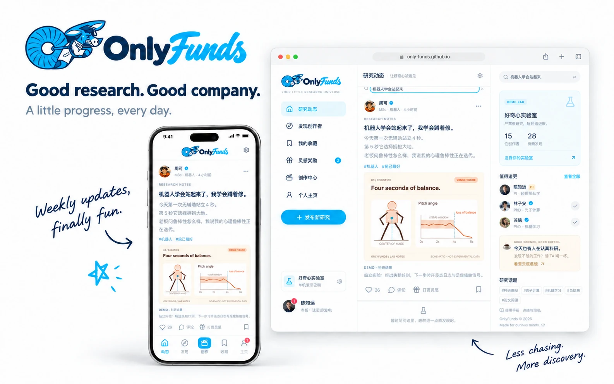
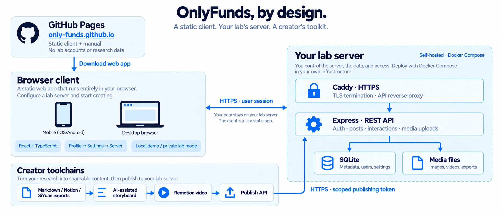

<div align="center">

# 🧪 OnlyFunds

**科研值得被看见。给拉磨的 PhD 一点掌声，也给一点咖啡。**

[🌐 打开 App](https://only-funds.github.io) · [📚 在线手册](https://only-funds.github.io/manual/) · [🛠️ 部署指南](docs/deployment.md) · [🎬 创作者指南](docs/creator-guide.md)



**📱 Mobile first · 🏠 Self-hosted · 🎓 Made for research labs**

</div>

OnlyFunds 是一个面向大学科研实验室的研究动态 App。学生发布周报、论文笔记和讲解视频；导师追更、评论下一步、收藏成果，偶尔奖励一杯咖啡、一晚 GPU，或者一张组会免战牌。熟悉的订阅式信息流，让汇报进度轻松一点。

> 🧭 浏览器打开就能体验。连接实验室后，账号与科研数据保存在你指定的服务器。订阅费用与奖励是组内承诺，平台不扣款、不转账。

## ✨ 你可以做什么

| 场景 | 能力 |
| --- | --- |
| 🔬 提交研究进度 | 文字笔记、论文来源、科研配图、视频周报、标签与搜索 |
| 🧑‍🏫 追更同门 | 按身份、年级、交换身份与费用筛选；导师 → 博士后 → 博士生 → 硕士生 → 本科生 |
| 💬 交流下一步 | 评论、点赞、私有收藏、创作者主页与订阅者名单 |
| 🪙 自定义订阅 | 多档计划、免费计划、反向资助、一次性学生活动；记录各期约定 |
| ☕ 兑现一点快乐 | 自定义 Emoji 奖励、收入 / 账单、使用申请、未读提醒、兑现起止时间 |
| 🎬 创作者工具链 | Markdown / Notion / 思源导出 → 分镜 → Remotion → 发布 API |
| 🐳 本机演示 | 15 位虚构组员、28 条带科研配图的动态，以及一点实验室彩蛋 |

## 🏗️ 架构：你的实验室，你的数据



| 模块 | 技术 / 运行位置 | 职责与边界 |
| --- | --- | --- |
| 📱 `client/` | React · TypeScript · Vite / 浏览器 | 静态网页、手机优先；在 **个人主页 → 设置** 指定服务器 |
| 🏠 `server/` | Node.js 24 · Express · SQLite / 实验室 Docker | 认证、科研内容、媒体、订阅、奖励与私有账本；Caddy 提供 HTTPS |
| 🎞️ `creator_toolchains/` | Python · Remotion · 发布 CLI / 创作者电脑 | 整理笔记、辅助制作视频，以有限权限发布密钥上传；AI 服务由创作者自行选择 |
| 🧩 `shared/` | 共享日期逻辑 | 订阅期次计算与月末边界处理 |
| 📚 `docs/` | Sphinx · MyST · Furo | 用户手册、API、部署、开发标准与品牌设计记录 |
| 🚀 `scripts/` | 开发、媒体生成、发布审计与打包 | 重现演示资源，检查敏感内容，生成纯静态站点包 |

GitHub Pages 只分发客户端与手册；浏览器直接连接选定的实验室服务器。本机演示使用虚构数据，保存在浏览器中，与真实实验室账号隔离。公开封面和架构图由 GPT-Image 生成，截图来自演示账号；手写短评是宣传文案，不是真实用户背书。

## 🚀 快速使用

### 📲 我只想先看看

1. 打开 **[only-funds.github.io](https://only-funds.github.io)**。
2. 直接体验演示；可以在设置中切换老板 / 创作者视角。
3. 使用真实实验室时，进入 **个人主页 → 设置 → 实验室服务器**，填写如 `https://serve.mylab.org`，验证并连接。
4. 用管理员提供的学生或导师邀请码注册，开始发布与追更。

### 🐳 为实验室部署服务端

准备 Docker Compose、Node.js 24+ 和服务器域名，然后在仓库根目录执行：

```bash
git clone git@github.com:only-funds/only-funds.git
cd only-funds
npm run setup
```

脚本生成仅本机可读的 `server/.env`。编辑其中的 `LAB_NAME`、`LAB_DOMAIN`、`ACME_EMAIL`，并让 `ALLOWED_ORIGINS` 包含 `https://only-funds.github.io`。保管好随机生成的会话密钥与两类邀请码。

```bash
# 正式部署：API + Caddy HTTPS
docker compose -f server/compose.yaml --profile https up -d --build

# 检查服务状态
docker compose -f server/compose.yaml ps
```

本机测试或已有反向代理时，省略 `--profile https`。数据库与上传媒体保存在 Docker volume 中。域名、TLS、备份和恢复步骤见 [部署](docs/deployment.md) / [运维](docs/operations.md)。

### 💻 本地开发

```bash
npm ci
npm run setup
npm run dev
```

| 本地入口 | 地址 |
| --- | --- |
| 📱 Web App | `http://127.0.0.1:5173` |
| 🧪 API 健康检查 | `http://127.0.0.1:8787/api/health` |
| 🎥 Remotion Studio | 运行 `npm run video:studio` |

### ✅ 检查与构建

```bash
npm run check              # TypeScript + 行为测试 + 生产构建
npm run audit:release      # 检查 Git 候选文件中的敏感信息
npm run demo:figures       # 重建 28 张压缩科研示意图

python3 -m venv .venv-docs
.venv-docs/bin/pip install -r docs/requirements.txt
.venv-docs/bin/sphinx-build -W -d output/doctrees -b html docs client/public/manual
npm run build
npm run site:prepare       # 生成 output/site/，包含客户端和手册
```

需要 Node.js **24+**；完整文档构建使用 Python **3.13**。发布脚本拒绝数据库、环境文件、符号链接和非静态文件，避免把本机缓存与实验室数据带到公开站点。

## 📂 工程目录

```text
only-funds/
├── client/                  # 浏览器客户端与已压缩的演示资源
├── server/                  # REST API、SQLite、Docker Compose
├── creator_toolchains/      # 笔记导入、Remotion、发布 CLI、AI skills
├── shared/                  # 共享逻辑
├── docs/                    # 手册、规范、README 图片与提示词
├── scripts/                 # 开发、制图、审计、静态站点打包
├── .github/workflows/       # 持续集成
├── .readthedocs.yaml        # 独立 Read the Docs 构建入口
└── output/                  # 本机生成物、备份、截图；不入 Git
```

## 📖 从这里继续

| 你想了解 | 文档 |
| --- | --- |
| 🌱 连接、注册与第一条研究 | [快速开始](docs/quickstart.md) · [用户手册](docs/user-manual.md) |
| 🪙 订阅、礼物使用与账单 | [订阅与账本](docs/subscriptions-and-ledger.md) |
| 🎬 从笔记到讲解视频 | [创作者指南](docs/creator-guide.md) · [示例笔记](creator_toolchains/examples/notes.md) |
| 🏠 搭建与维护实验室 | [部署](docs/deployment.md) · [运维](docs/operations.md) · [排障](docs/troubleshooting.md) |
| 🧩 扩展和二次开发 | [架构](docs/architecture.md) · [API](docs/api.md) · [开发标准](docs/standards.md) |
| 🔐 公开发布前检查 | [隐私与发布流程](docs/publishing.md) |
| 🎨 封面、架构图与演示媒体 | [README 视觉资产](docs/readme-visuals.md) · [媒体预算](docs/demo-media.md) |
| 📚 维护手册 | [文档构建与 Read the Docs](docs/documentation.md) |
| 🧪 当前版本与验证范围 | [版本说明](docs/release-notes.md) · [验证记录](docs/verification.md) |

## 🌍 两个仓库，各司其职

| 仓库 | 内容 | 对应入口 |
| --- | --- | --- |
| [`only-funds/only-funds`](https://github.com/only-funds/only-funds) | 源码、测试、配置模板和文档 | 本仓库 |
| [`only-funds/only-funds.github.io`](https://github.com/only-funds/only-funds.github.io) | 审计后的静态客户端与 HTML 手册 | [App](https://only-funds.github.io) · [Manual](https://only-funds.github.io/manual/) |

本机 `.env`、SQLite、上传内容、备份、密钥、浏览器状态与调试截图均不应提交。发现泄漏时先撤销相关凭据，再处理历史；不要把秘密粘贴到公开 Issue 中。

<div align="center">

**🔬 Serious research. ☕ Small rewards. 🫏 Slightly overworked donkeys.**

</div>
